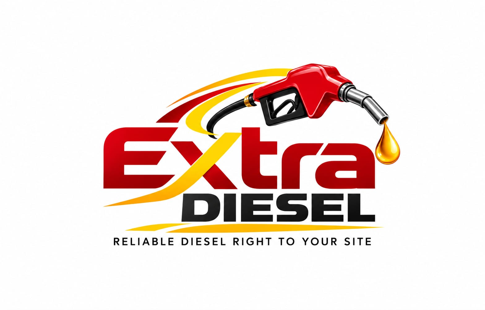

# Extra Diesel — Mobile-First Diesel Delivery Application

<div align="center">
  
  <p><strong>Reliable Diesel Right To Your Site</strong></p>
  <p>Production-ready mobile-first on-demand doorstep diesel delivery platform with real-time GPS fleet tracking, subscription scheduler, B2B corporate credit management, and location manager dispatch hub.</p>
</div>

---

## 📱 Features & Implemented Mobile Screens (Matching 8-Screen Design Spec)

1. **Screen 1 — Splash / Welcome Screen**
   - Official Extra Diesel brand logo with tagline *"Reliable Diesel Right To Your Site"*.
   - High-definition diesel delivery bowser tanker truck illustration with city backdrop.
   - Core headline: *"Fuel Delivered At Your Doorstep"*.
   - Three value indicators: Safe & Secure (PESO approved), On-Time Delivery, and Trusted Partner.
   - Primary red gradient *"Get Started →"* action button with smooth authentication-aware routing.

2. **Screen 2 — Login / Registration**
   - Brand logo and *"Welcome Back!"* header.
   - Phone input with Indian `+91` validation and icon.
   - Interactive OTP authentication service with 6-digit box auto-focus and 30-second resend countdown timer.
   - Google Sign-In integration.
   - Registration flow for new customers with real persistent account creation.
   - Decorative city skyline with brand yellow and red curved accents.

3. **Screen 3 — Home Dashboard**
   - Branded red header with functional navigation drawer, notification bell (with unread badge), and centered official logo badge.
   - Daily diesel rate ticker with live price (₹94.50/L) and best price indicator.
   - Animated hero slider banner showcasing doorstep delivery, automated smart metering, and corporate fleet benefits.
   - 4 Core Service Cards in a 2x2 grid:
     - ⛽ **Order Diesel**
     - 📋 **My Orders**
     - 📅 **Subscription**
     - 🏢 **Business (B2B)**
   - *"Our Services"* showcase with Residential (B2C) and Commercial Fleets.
   - Responsive bottom navigation bar (Home, Orders, Track, Profile).

4. **Screen 4 — Order Diesel**
   - Delivery Location selector with interactive *"Change"* modal to choose from saved sites or add new locations.
   - Quantity selector cards with quick presets (200L, 300L) and custom liter input/stepper.
   - Delivery Type selector (One-Time Delivery vs. Recurring Subscription Delivery).
   - Equipment / Vehicle dropdown (Delivery Truck, DG Sets, Commercial Fleets, Excavator, Storage Tanks).
   - Dynamic real-time invoice calculation: Fuel Subtotal, 5% GST, Free Delivery fee over 200L, and Total Payable.
   - Order Review & Payment Modal supporting UPI (GPay/PhonePe), Corporate Credit, Cards, and Cash on Delivery with celebratory confetti.

5. **Screen 5 — Live Order Tracking**
   - Green confirmation banner with Order ID (e.g., `#ED20261114`).
   - Vertical milestone timeline: Order Placed → Order Confirmed → Out for Delivery → Arriving Soon → Delivered.
   - Interactive live GPS map with moving delivery tanker bowser along telematics route.
   - Delivery Driver card (Ramesh Kumar, Bowser TS 09 ED 7721) with one-click direct phone dialer (`tel:`) and instant WhatsApp chat.

6. **Screen 6 — My Orders**
   - Filter pill tabs: **All**, **Pending**, and **Delivered**.
   - Order cards with bowser thumbnails, order IDs, date/time, fuel volume, and status pills.
   - Detailed itemized invoice modal with rate breakdown, delivery site address, driver information, and digital invoice download.

7. **Screen 7 — Scheduled Subscription Delivery**
   - Highlight banner: *"Never run out of diesel again!"*.
   - Flexible frequency selection: **Weekly**, **Monthly**, or **Selected Days**.
   - Preferred day picker supporting multi-day recurring orders (Mon–Sun).
   - Fuel volume picker (100L to 2,000L).
   - Active Subscriptions management list with pause and cancel controls.

8. **Screen 8 — My Profile & Account Center**
   - Customer profile card with verified badge and profile editing modal.
   - Interactive account menu:
     - 📍 **My Addresses** (Add, edit, delete delivery sites)
     - 📋 **My Orders** (Order history and tracking)
     - 📅 **Subscription Plans** (Recurring schedule)
     - 🧾 **Tax Invoices** (Official GST receipts)
     - 💳 **Payment Methods** (UPI, credit wallet, cards)
     - ❓ **Help & Support** (24/7 hotline & WhatsApp)
     - ℹ️ **About Us** (PESO compliance, BS-VI standards, W&M meters)
     - ⚙️ **Settings** (App notifications & preferences)
     - 🚪 **Logout** with session cleanup.

9. **Additional Business & Manager Capabilities**
   - **Corporate B2B Portal**: KYB verification status, GSTIN, fleet equipment / generator asset tracking, fuel credit line limit (₹5,00,000) and monthly consumption reports.
   - **Operations & Dispatch Hub**: Live depot bowser telematics, inventory stock monitoring (12,400L), and order status progression controls.

---

## 🎨 Brand Design Language

- **Primary Red**: `#D50000`
- **Deep Red**: `#B90000`
- **Yellow**: `#FFD600`
- **Dark Text**: `#171717`
- **Light Background**: `#F7F8FA`
- **Soft Gray**: `#E9EDF2`
- **Official Brand Logo**: Extra Diesel with fuel nozzle dispenser and golden drop.

---

## 💻 Tech Stack & Architecture

- **Frontend**: React 18, TypeScript, Vite
- **Styling**: Tailwind CSS with custom brand palette & responsive breakpoints
- **Icons**: Lucide React
- **Celebration Effects**: Canvas Confetti
- **State & Persistence**: LocalStorage persistence with an asynchronous API adapter (`src/services/api.ts`) ready for Supabase or custom REST backend.
- **Mobile-First Responsive**: Built-in device simulator ribbon for testing at 360px, 390px, 414px, 430px, and full desktop layout.

---

## 🚀 Getting Started

### Prerequisites
- Node.js (v18 or newer)
- npm or pnpm

### Installation

```bash
# Clone the repository
git clone https://github.com/shaikmuzammil2905/Extra-diesel.git
cd Extra-diesel

# Install dependencies
npm install

# Start local development server
npm run dev
```

### Production Build

```bash
npm run build
npm run preview
```

---

## 📜 Compliance & Safety Standards

- **PESO**: Petroleum and Explosives Safety Organization licensed mobile dispensing.
- **Weights & Measures**: Legal Metrology calibrated flow meters with automated digital thermal density printouts.
- **Fuel Standard**: 100% Bharat Stage VI (BS-VI) ultra-low sulfur high-speed diesel.
